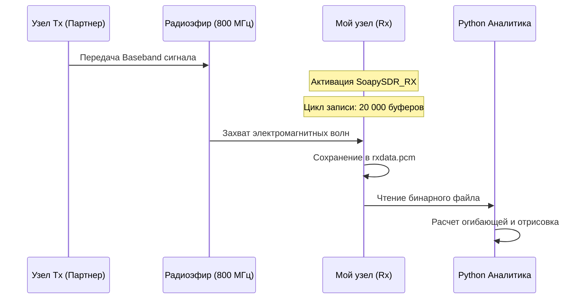

# Отчет по приему и программной демодуляции радиосигналов (ADALM-Pluto)

<p align="center">
  
  
  
  
  
</p>

> **Период выполнения:** Недели 4, 5, 6 (28.09 - 18.10)
>
> **Тема:** Организация радиоканала связи между двумя платами SDR. Настройка узла приема (Rx), захват эфира и математическая обработка сырых I/Q данных.

## 📸 1. Аппаратная установка (Фотоотчет)

В рамках лабораторного стенда использовались два независимых компьютера с подключенными платами ADALM-Pluto. В данном эксперименте мой узел был сконфигурирован для работы в качестве **радиоприемника (Rx)**. 

<p align="center">
  
</p>

## 📡 2. Программная конфигурация приемного узла (Rx)

Для перехода от loopback-тестирования к реальному приему сигнала из эфира потребовалось модифицировать C++ код драйвера, отключив логику передачи (Tx). Был реализован парсинг аргументов командной строки, позволяющий запускать бинарный файл в режиме прослушивания.

**Основные изменения в логике приема:**
1. **Отключение Tx:** Поток `SOAPY_SDR_TX` и связанные с ним функции генерации трапециевидного сигнала были закомментированы/изолированы.
2. **Расширение окна приема:** Для гарантированного захвата сигнала от удаленного передатчика размер цикла записи эфира был увеличен с 10 до 20000 итераций (`iteration_count = 20000`). Это обеспечило непрерывную запись сэмплов в файл `rxdata.pcm` на протяжении 8-10 секунд.



## 🛠 3. Отладка процесса приема и программные решения

При попытке установить связь и визуализировать данные был выявлен ряд проблем, потребовавших аналитического подхода.

### 📂 3.1. Ошибка маршрутизации файловой системы (FileNotFoundError)

* **Проблема:** Аналитический Python-скрипт прерывал работу с ошибкой: `FileNotFoundError: [Errno 2] No such file or directory: 'build/txdata.pcm'`.
* **Причина:** Изначальный скрипт был жестко запрограммирован на чтение файла передатчика (`txdata.pcm`). Однако мой C++ код приемника сохранял дамп радиоэфира под логически корректным именем `rxdata.pcm`.
* **Решение:** В коде `readPcm.py` переменная пути была исправлена на `name = "build/rxdata.pcm"`.

### 📉 3.2. Диагностика белого шума в радиоканале

* **Проблема:** После успешного запуска скрипта на графике отображался только белый шум (амплитуда от -4 до 4 единиц АЦП). Полезный сигнал отсутствовал.
* **Причина (на стороне Tx):** Диагностика показала, что приемный тракт работает корректно, однако аппаратное усиление передатчика партнера было выставлено на `-40.0` дБ (практически полное подавление сигнала).
* **Решение:** Совместно с партнером усиление его передатчика было скорректировано до `0.0` дБ (максимальная программная мощность). После этого сигнал пробил шумовую полку и был успешно записан моим узлом.

## 🧮 4. Демодуляция и математическая обработка I/Q сигнала

При визуализации сырых принятых данных каналов $I$ (In-phase) и $Q$ (Quadrature) вместо переданного партнером трапециевидного импульса наблюдались высокочастотные колебания (синусоидальные биения).

**Физика явления (Смещение несущей):**
Данный эффект обусловлен рассинхронизацией аппаратных генераторов (гетеродинов) двух разных плат ADALM-Pluto. Разница частот $\Delta f$ между передатчиком и приемником приводит к появлению фазового множителя $e^{j2\pi\Delta ft}$ при переносе частоты в Baseband. В комплексной плоскости это выглядит как постоянное вращение вектора сигнала, что на графике проекций $I$ и $Q$ дает осцилляции.

**Извлечение полезного сигнала (Огибающая):**
Для компенсации фазовых вращений и получения амплитудного профиля сигнала (огибающей), я применил математический аппарат векторной алгебры. Мгновенная амплитуда комплексного сигнала вычисляется как длина вектора по теореме Пифагора:

$$
Envelope = \sqrt{I^2 + Q^2}
$$

**Оптимизация Python-кода:**
Для обработки массива из почти 40 миллионов значений (20000 буферов по 1920 сэмплов) оригинальный скрипт был переписан с использованием библиотеки NumPy. Векторизация вычислений позволила отрисовать график практически мгновенно.

```python
import numpy as np
import matplotlib.pyplot as plt

# Указан верный путь к файлу приемника
name = "build/rxdata.pcm"
real = []
imag = []

# Чтение бинарного дампа эфира
with open(name, "rb") as f:
    index = 0
    while (byte := f.read(2)):
        val = int.from_bytes(byte, byteorder='little', signed=True)
        if index % 2 == 0:
            real.append(val)
        else:
            imag.append(val)
        index += 1

# Конвертация в массивы NumPy для векторизованных вычислений
real_np = np.array(real)
imag_np = np.array(imag)

# Вычисление математической огибающей (амплитудной демодуляции)
envelope = np.sqrt(real_np**2 + imag_np**2)

# Построение графика
plt.figure(figsize=(12, 6))
plt.title("Огибающая принятого трапециевидного сигнала", fontsize=14)
plt.xlabel("Номер сэмпла", fontsize=12)
plt.ylabel("Амплитуда", fontsize=12)
plt.plot(envelope, color='green', linewidth=1.5)
plt.grid(True, linestyle='--', alpha=0.7)
plt.show()
```

## ✅ Заключение

В ходе лабораторной работы была успешно настроена приемная часть SDR-системы на базе ADALM-Pluto. Осуществлен захват радиоэфира в автономном режиме. Применены методы программной диагностики для выявления проблем на стороне передатчика, а также успешно реализован алгоритм амплитудной демодуляции (вычисления огибающей) на языке Python, позволивший устранить влияние несинхронности гетеродинов и восстановить исходную форму переданного сигнала.
