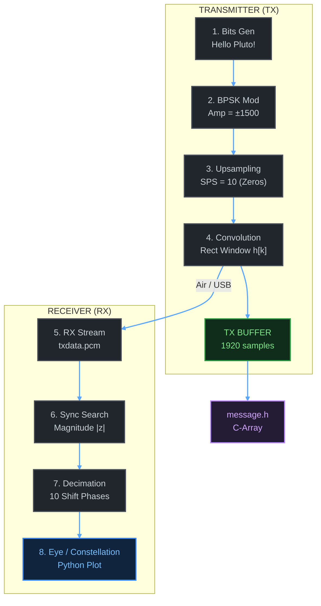

## Программно-определяемый приемопередатчик на базе Adalm-Pluto SDR

Репозиторий содержит исходный код, скрипты спектрального и временного анализа, а также инженерные отчеты по разработке цифровой системы связи на базе программно-определяемого радио **Analog Devices ADALM-PLUTO (PlutoSDR)**.

Проект охватывает полный цикл проектирования физического уровня (PHY): от базового приема радиовещательных сигналов в GNU Radio до низкоуровневой реализации приемопередатчика на языке C/C++ с использованием аппаратных временных меток (Hardware Timestamps), формирования импульсов методом дискретной свертки, BPSK-модуляции и алгоритмов символьной синхронизации.

---

## Сводная таблица отчетов (Summary)

Детальные отчеты с математическими выводами, графиками и разбором архитектуры распределены по папкам соответствующих недель.

| Недели | Тема лабораторной работы | Отчет |
| :---: | :--- | :--- |
| **1–2** | GNU Radio. Построение FM-радиоприемника | [Week_1-2](Reports/Week_1-2/) |
| **3** | Инициализация ADALM-Pluto и аппаратные метки времени (Timestamp) | [Week_3](Reports/Week_3/) |
| **4–6** | Работа с I/Q-буферами и радиоканал между платами | [Week_4-5-6](Reports/Week_4-5-6/) |
| **7** | Разделение ролей TX/RX и подготовка модуляции | [Week_7](Reports/Week_7/) |
| **8** | Передатчик BPSK, дискретная свертка и анализ радиоканала | [Week_8](Reports/Week_8/) |
| **9** | Приемник. Детерминированный кадр и выбор символьных отсчетов | [Week_9](Reports/Week_9/) |
| **10** | Приемник. Согласованный фильтр, 10 фаз и ошибка Гарднера | [Week_10](Reports/Week_10/) |
| **11** | Замкнутая синхронизация Гарднера (CDR) и дашборд Dear ImGui + ImPlot | [Week_11](Reports/Week_11/) |

---

## Архитектура системы



---

## Установка и сборка проекта

### 1. Клонирование репозитория и инициализация сабмодулей

Проект использует специализированные ветки библиотек с поддержкой аппаратных таймстемпов ADALM-Pluto, подключенные через механизм `git submodule`.

```bash
git clone --recurse-submodules https://github.com/<ваш-логин>/SDR.git
cd SDR
```

Если репозиторий уже был склонирован без флага `--recurse-submodules`, загрузите подмодули командой:

```bash
git submodule update --init --recursive
```

### 2. Установка системных зависимостей (Linux Mint / Ubuntu / Debian)

```bash
sudo apt-get update
sudo apt-get install -y build-essential cmake pkg-config \
    libusb-1.0-0-dev libxml2-dev bison flex libcdk5-dev \
    libaio-dev libavahi-common-dev libavahi-client-dev \
    python3 python3-numpy python3-matplotlib swig
```

### 3. Компиляция основного проекта

Сборка выполняется в изолированной директории `build/` (убедитесь, что эта директория не индексируется Git, она должна быть в `.gitignore`):

```bash
mkdir -p build && cd build
cmake ..
make -j$(nproc)
```

После успешной компиляции в директории `build/` появится исполняемый файл `main`.

---

## Инструкция по запуску

Проверка доступности подключенной платы ADALM-Pluto и определение ее URI выполняются утилитой:

```bash
iio_info -s
```

### Запуск в режиме приемника (RX)

На первом компьютере запускается приемник. Он инициализирует поток чтения, записывает принятые из эфира комплексные отсчеты в файл `build/txdata.pcm` и ожидает пакеты на протяжении 3000 буферов:

```bash
cd build
sudo ./main rx
```

### Запуск в режиме передатчика (TX)

На втором компьютере запускается передатчик. Программа формирует BPSK-сигнал из фиксированной текстовой строки `"Hello Pluto!"`, сохраняет эталонный массив сэмплов в заголовочный файл `message.h` и излучает каждый второй буфер в радиоэфир на частоте 800 МГц:

```bash
cd build
sudo ./main tx
```

### Визуализация и анализ данных (Python)

После завершения работы приемника запустите скрипт анализа из корневой директории проекта. Он автоматически найдет полезный сигнал в `txdata.pcm`, построит временные огибающие, созвездие и выполнит децимацию (сдвиги) для символьной синхронизации:

```bash
python3 readPcm.py
```
