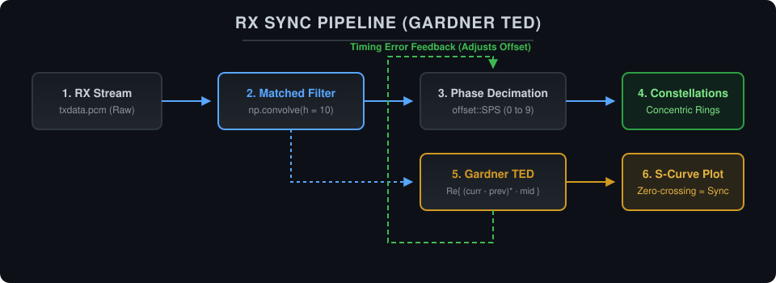

# Отчет по лабораторной работе №10: Согласованная фильтрация на приемнике, выбор символьных отсчетов (10 фаз) и символьная синхронизация Гарднера

---

## 1. Постановка задачи и цели недели

На предыдущем этапе (Неделя 9) на передатчике был сформирован детерминированный BPSK-сигнал, содержащий строку `"Hello Pluto!"` и имеющий длительность символа `sps = 10` сэмплов. Затем принятый радиосигнал был записан в бинарный файл `txdata.pcm`.

Однако при первоначальном анализе диаграммы созвездия возникла проблема: вместо ожидаемого распределения точек наблюдалось практически идеальное гладкое кольцо. При этом изменение фазы стробирования не приводило к заметным изменениям графика.

**Основные цели текущей недели:**

1. **Анализ и устранение ошибок предыдущей недели.** Определить физические и математические причины появления гладкого кольца на диаграмме созвездия при отсутствии приемного фильтра. Дополнительно исправить обработку разрядности 12-битного ЦАП (`<< 4`) и аппаратных меток времени (`SOAPY_SDR_HAS_TIME`) в `dev/main.cpp`.

2. **Реализация согласованной фильтрации на приемнике (Matched Filter).** Добавить дискретную свертку принятого комплексного сигнала с прямоугольным окном длиной `SPS = 10` перед построением диаграмм созвездия.

3. **Анализ 10 фаз стробирования.** Разделить отфильтрованный сигнал на 10 независимых подпоследовательностей со сдвигами `0..9` и шагом `10`. Исследовать, как при изменении фазы выборки меняется структура концентрических колец на диаграмме созвездия.

4. **Реализация детектора ошибки синхронизации Гарднера (Gardner TED).** Вычислить и построить S-кривую ошибки Гарднера в зависимости от фазы стробирования, чтобы определить оптимальный момент выборки символа автоматически.

5. **Подготовка окружения для Dear ImGui.** Установить необходимые системные графические библиотеки (`libsdl2-dev`, `libgl1-mesa-dev`) и подготовить репозитории `imgui` и `implot` для последующего перехода к интерактивной визуализации в реальном времени.

---

## 2. Архитектура приемного тракта и физика появления колец

Ниже приведена векторная блок-схема, описывающая последовательность обработки сигнала на приемнике. Она также показывает физическую причину появления нескольких колец на диаграмме созвездия при неправильном выборе фазы стробирования.

<div align="center">



</div>

---

## 3. Анализ ошибок предыдущей недели и внесенные исправления

### 3.1. Диаграмма созвездия до добавления приемной свертки (Неделя 9)

На предыдущей неделе диаграмма созвездия строилась непосредственно по исходным отсчетам, считанным из файла `txdata.pcm`. В результате получилась следующая картина:


**Почему полученный график выглядел практически идеальным и не позволял определить оптимальную фазу символа?**

Причины оказались связаны с двумя различными аспектами: алгоритмической обработкой данных в Python и аппаратной настройкой передатчика в C++.

1. **Отсутствие согласованной фильтрации на приемнике (Matched Filter).**

   На передатчике каждый бит со значением `+1500` или `-1500` проходил через прямоугольное окно из 10 единиц. В результате формировалась плоская последовательность из 10 одинаковых отсчетов.

   Если на приемнике не выполнять обратную свертку, амплитуда каждого отдельного отсчета внутри символа остается практически неизменной: $\vert z[n]\vert \approx 1650$.

   Из-за частотного рассогласования гетеродинов (CFO) вектор сигнала вращается по окружности, сохраняя постоянную длину. Поэтому независимо от того, какой из десяти отсчетов выбран — фаза `0`, фаза `4` или фаза `9`, — радиус точки остается одинаковым. Именно поэтому все десять фаз формировали практически одну и ту же гладкую окружность.

2. **Отсутствие побитового сдвига `<< 4` и флага `SOAPY_SDR_HAS_TIME` в `dev/main.cpp`.**

   - При прямой работе с буферами (`direct=1`) 12-битный ЦАП трансивера AD9361 использует старшие 12 бит 16-битного слова `int16_t`. Фактически аппаратная часть делит переданное значение на 16. Поэтому для передачи сигнала с полной амплитудой результат свертки необходимо сдвигать влево на 4 бита (`<< 4`), то есть умножать на 16.

   - Кроме того, при вызове `SoapySDRDevice_writeStream` в `main.cpp` использовались флаг `flags_tx = 0` и нулевое значение времени. Вместо них требовалось передавать константу `SOAPY_SDR_HAS_TIME` и рассчитанное значение `tx_time`.

### 3.2. Исправления в файле `dev/main.cpp`

В исходном коде передатчика `dev/main.cpp` были изменены два основных участка.

**Исправление №1 (строки 126–127) — согласование данных с 12-битным ЦАП:**

```cpp
// БЫЛО:
tx_buff[2 * i]     = (int16_t)sum_I; 
tx_buff[2 * i + 1] = 0;


// СТАЛО (добавлен побитовый сдвиг << 4):
tx_buff[2 * i]     = ((int16_t)sum_I) << 4; 
tx_buff[2 * i + 1] = 0;
```

**Исправление №2 (строки 199–200) — включение аппаратной временной метки при передаче:**

```cpp
// БЫЛО:
int flags_tx = 0; 
int st = SoapySDRDevice_writeStream(sdr, txStream, (const void * const*)tx_buffs, tx_mtu, &flags_tx, 0, timeoutUs);


// СТАЛО (включен флаг SOAPY_SDR_HAS_TIME и передано время tx_time):
int flags_tx = SOAPY_SDR_HAS_TIME; 
int st = SoapySDRDevice_writeStream(sdr, txStream, (const void * const*)tx_buffs, tx_mtu, &flags_tx, tx_time, timeoutUs);
```

---

## 4. Согласованная фильтрация на приемнике и анализ полученных графиков

Радиоканал передает сигнал, одновременно внося в него шум и другие искажения. Поэтому одна из задач оптимального приемника заключается в том, чтобы собрать энергию, распределенную по десяти отсчетам одного символа, и получить результат в одной точке.

Для этого в Python-скрипт перед построением диаграмм созвездия была добавлена свертка принятого сигнала с согласованным прямоугольным фильтром длиной $\text{SPS} = 10$:

\[
h_{\text{RX}}[k] = [1, 1, 1, 1, 1, 1, 1, 1, 1, 1]
\]

Математически операция описывается выражением:

\[
y[n] = \sum_{k=0}^{9} r[n - k] \cdot h_{\text{RX}}[k]
\]

### 4.1. Изменение сигнала после свертки на приемнике


**Подробный анализ Рис. 2:**

1. **Левый график (сигнал во времени).** На графике отчетливо различимы участки передачи полезного сигнала. Зеленая огибающая $\vert z\vert$ уменьшается до нуля при изменении фазы BPSK на $180^\circ$, а также во время защитных интервалов между пакетами.

2. **Правый график (созвездие после свертки RX).** После применения приемной свертки форма сигнала изменяется: прямоугольные импульсы приобретают треугольную структуру. Это объясняется тем, что при переходе от бита `+1` к биту `-1` сумма в окне фильтра изменяется постепенно, а не скачкообразно.

   - Если все 10 отсчетов внутри окна соответствуют одному биту, сумма достигает максимального значения ($\approx 6000$). На диаграмме это соответствует **внешнему фиолетовому кольцу**.

   - Если окно фильтра смещается и захватывает, например, 7 положительных и 3 отрицательных отсчета, их значения частично компенсируют друг друга: $7 - 3 = +4$. В результате формируется точка на четвертом кольце.

   - Если внутри окна находятся 5 положительных и 5 отрицательных отсчетов, их сумма становится равной нулю, и точка располагается в центральной области диаграммы.

Таким образом, появление нескольких вложенных колец на полном графике объясняется наличием промежуточных состояний сигнала во время переходов между соседними символами.

### 4.2. Разделение диаграммы созвездия на 10 фаз стробирования (0..9)

Для демодуляции приемнику необходимо выбирать только **один отсчет из каждых десяти**. Это выполняется путем децимации с шагом `SPS = 10`.


**Интерпретация Рис. 3:**

- **Неправильные фазы (`Фаза: 0..2` и `Фаза: 6..8`).** В этих случаях момент выборки расположен близко к границе между соседними символами. Поэтому окно фильтра захватывает части двух разных битов. Если значения битов отличаются, происходит взаимная компенсация их вкладов, из-за чего точки смещаются на внутренние кольца.

- **Оптимальная фаза (`Фаза: 4` и `Фаза: 9`).** На **Фазе 4** промежуточные орбиты полностью исчезают, и остается только чистое внешнее кольцо. Это указывает на то, что окно фильтра располагается внутри границ одного символа и не захватывает соседние биты. Следовательно, межсимвольная интерференция отсутствует.

### 4.3. S-кривая ошибки Гарднера в зависимости от фазы стробирования

По диаграммам на Рис. 3 визуально можно определить, что наилучший результат дает **Фаза 4**. Чтобы приемник мог самостоятельно находить это положение, был реализован **детектор ошибки синхронизации Гарднера (Gardner TED)**.

Алгоритм использует три отсчета для каждого символа $k$ при проверяемой фазе $m$:

- $y_{\text{curr}}[k] = y[k \cdot 10 + m]$ — текущий символьный отсчет;
- $y_{\text{prev}}[k] = y[(k - 1) \cdot 10 + m]$ — отсчет предыдущего символа;
- $y_{\text{mid}}[k] = y[k \cdot 10 - 5 + m]$ — отсчет, расположенный ровно посередине между ними.

Средняя ошибка Гарднера для выбранной фазы $m$ рассчитывается по формуле:

\[
e(m) = \frac{1}{K} \sum_{k=1}^{K} \text{Re}[ (y_{\text{curr}}[k] - y_{\text{prev}}[k])^\* \cdot y_{\text{mid}}[k] ]
\]


**Проверка корректности работы алгоритма:**

Если отсчеты `prev` и `curr` выбираются в идеальных центрах символов, промежуточная точка `mid` оказывается непосредственно на переходе через ноль при изменении знака бита. В результате умножение разности отсчетов на нулевое значение дает нулевую ошибку.

На Рис. 4 видно, что кривая пересекает черную пунктирную линию нулевого уровня именно при **`Фаза = 4`**. Это подтверждает результат, полученный при визуальном анализе диаграмм созвездия.

---

## 5. Исходный код Python-скрипта

Полная реализация Python-скрипта, включающая поиск активного пакета, согласованную свертку, построение диаграмм созвездия для 10 фаз и вычисление S-кривой ошибки Гарднера, находится в отдельном файле:

👉 **[scripts/readPcm.py](/scripts/readPcm.py)**

---

## 6. Подготовка к интеграции графического интерфейса Dear ImGui

Еще одним направлением работы на этой неделе стала подготовка программной среды для перехода от оффлайн-обработки данных в Python к интерактивному приложению на C++ с использованием **Dear ImGui** и **ImPlot**.

При установке пакетов разработки `libsdl2-dev` и `libgl1-mesa-dev` возникли две проблемы: блокировка менеджера пакетов `dpkg` из-за ранее прерванной сессии и ограничения контейнерной среды `no new privileges` при работе через терминал VS Code.

Обе проблемы удалось устранить, перейдя в системный терминал Linux Mint (`Ctrl + Alt + T`) и выполнив следующие команды:

```bash
# Восстановление базы пакетов
sudo dpkg --configure -a


# Установка графических библиотек
sudo apt-get update
sudo apt-get install libsdl2-dev libgl1-mesa-dev
```

Дополнительно в каталог `third_party` были склонированы репозитории [imgui](https://github.com/ocornut/imgui) и [implot](https://github.com/epezent/implot). В дальнейшем они будут непосредственно подключены к проекту через `CMakeLists.txt`.

---

## 7. Выводы

1. Установлена и устранена причина появления гладкого кольца на диаграмме созвездия. Показано, что при отсутствии согласованного фильтра на приемнике прямоугольные импульсы сохраняют постоянный модуль на всех десяти отсчетах одного символа.

2. В файле `dev/main.cpp` восстановлен побитовый сдвиг `<< 4`, необходимый для корректной работы с 12-битным ЦАП AD9361. Также активирована аппаратная синхронизация передачи с использованием `SOAPY_SDR_HAS_TIME`.

3. Реализована приемная свертка с прямоугольным окном `SPS = 10`. При анализе диаграмм созвездия обнаружено формирование нескольких вложенных колец на неправильных фазах и их схлопывание в одно кольцо при выборе оптимальной **Фазы 4**.

4. Реализован детектор ошибки синхронизации Гарднера. Полученная S-кривая подтвердила правильность выбора фазы: нулевое значение ошибки соответствует Фазе 4.

5. Подготовлено системное окружение и установлены необходимые зависимости для дальнейшей разработки интерактивного графического интерфейса на C++.