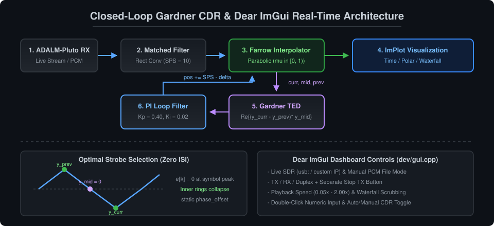

# Отчет по лабораторной работе №11: Интерактивный веб-дашборд на Dear ImGui + ImPlot и замкнутая петля символьной синхронизации Гарднера (Gardner CDR)

---

## 1. Постановка задачи и цели недели

На предыдущей неделе (Неделя 10) с помощью Python была исследована необходимость согласованной фильтрации на приемнике ($\text{SPS} = 10$). Были построены диаграммы для десяти фаз стробирования и рассчитана разомкнутая S-кривая ошибки Гарднера, позволившая определить оптимальный момент выборки символа.

Однако в реальных системах радиосвязи тактовые генераторы передатчика и приемника работают независимо друг от друга и постепенно накапливают временное рассогласование. Поэтому использование одной фиксированной фазы (`0..9`) не может обеспечить стабильную синхронизацию на протяжении неограниченного времени. Дополнительным ограничением оставался оффлайн-анализ в Python: он не позволял напрямую управлять трансивером ADALM-Pluto и наблюдать изменения сигнала в режиме реального времени.

**Основные цели текущей недели:**

1. **Разработка интерактивного графического дашборда (`gui.cpp`) на C++ с использованием SDL2 + OpenGL3 + Dear ImGui + ImPlot.** Перейти от статических графиков, формируемых отдельными скриптами, к полноценному нативному C++ приложению с частотой обновления $120\text{ FPS}$. Обеспечить поддержку кириллицы, динамическое обновление водопада (Waterfall), полярную сетку диаграммы созвездия и управление трансивером ADALM-Pluto в реальном времени.

2. **Реализация замкнутой петли символьной синхронизации (Closed-Loop Gardner CDR).** Внедрить в `main.cpp` и `gui.cpp` полноценную цифровую систему автоматической подстройки тактовой частоты (All-Digital PLL), опираясь на **Главу 6 учебника *"Software-Defined Radio for Engineers"* (T. Collins, R. Getz, D. Pu, A. Wyglinski)**. Реализация включает:
   - кусочно-параболический интерполятор Фарроу (Piecewise Polynomial Filter), позволяющий вычислять значения сигнала в дробных точках $\mu \in [0, 1)$;
   - детектор тактовой ошибки Гарднера (Gardner TED), устойчивый к вращению фазы несущей (CFO);
   - пропорционально-интегральный (ПИ) фильтр второго порядка и контроллер шага выборки.

3. **Решение инженерных задач интеграции и визуализации.** Исправить проблемы совместимости с обновленным API `ImPlotSpec`, сократить время компиляции тяжелых шаблонов `implot_items.cpp`, обеспечить синхронную перемотку всех трех графиков, включая ретроспективное восстановление истории Waterfall, а также добиться соответствия динамической диаграммы созвездия эталонному многофазному графику предыдущей недели.

---

## 2. Архитектура замкнутой петли синхронизации Гарднера и конвейера GUI

Ниже представлена блок-схема реализованного конвейера цифровой обработки сигнала на C++. Она охватывает весь процесс: от многопоточного получения I/Q-отсчетов через `SoapySDR` и согласованной фильтрации до замкнутой петли Гарднера с интерполятором Фарроу и последующего отображения данных средствами `ImPlot`.

<div align="center">



</div>

---

## 3. Теория символьной синхронизации по методическому пособию и ее реализация на C++

В **Главе 6 («Timing Synchronization», стр. 191–212)** учебника *Software-Defined Radio for Engineers* подробно рассматриваются причины временного рассогласования тактовых генераторов передатчика и приемника.

После прохождения радиоканала принятый непрерывный сигнал содержит неизвестную дробную задержку $\tau(t)$:

\[
r(t) = \sum_{n} x(n) h(t - \tau(t) - nT_s) + v(t)
\]

После согласованной фильтрации (Matched Filter) прямоугольные импульсы приобретают треугольную форму. Это связано с автокорреляционной функцией импульса:

\[
h_A(t) = h(t) * h^\*(-t)
\]

Чтобы получить максимальное отношение сигнал/шум (SNR) и устранить межсимвольную интерференцию (ISI), выборку необходимо выполнять непосредственно в максимуме треугольного импульса. Эта точка соответствует максимальному раскрытию глазковой диаграммы (Eye Diagram, рис. 6.13 методички).

Задержка $\tau(t)$ содержит **дробную составляющую относительно периода дискретизации** и постепенно изменяется из-за нестабильности кварцевых резонаторов ($25\text{ ppm}$ на ADALM-Pluto). По этой причине обычная децимация с использованием целочисленных индексов массива не способна постоянно удерживать выборку в максимуме символа.

В разделе **6.3.2 Feedback Timing Correction** (рис. 6.12 и 6.14) учебника описывается замкнутая структура цифровой ФАПЧ (PLL), состоящая из четырех основных узлов:

| Узел по учебнику (Chapter 6) | Математическая задача узла | Реализация в нашем C++ коде (`main.cpp` и `gui.cpp`) |
| :--- | :--- | :--- |
| **1. Interpolator (Piecewise Polynomial Filter, стр. 205)** | Вычисление комплексного значения сигнала $I/Q$ в произвольный дробный момент времени $n + \mu_k$, где $\mu_k \in [0, 1)$, используя 4 соседних отсчета АЦП. | Функция `InterpolateFarrow()`: реализует 4-точечную кусочно-параболическую схему Фарроу с параметром $\alpha = 0.5$ по формуле (6.17). |
| **2. Timing Error Detector (Gardner TED, стр. 208)** | Определение направления и величины отклонения момента выборки от центра символа по трем точкам: предыдущему символу $y_{\text{prev}}$, середине перехода $y_{\text{mid}}$ и текущему символу $y_{\text{curr}}$. | В функции `RunGardnerSymbolSync()` рассчитывается $e[k] = \text{Re}\{(y_{\text{curr}} - y_{\text{prev}})^\* \cdot y_{\text{mid}}\}$ согласно уравнению (6.19), с нормировкой на мощность пакета. |
| **3. Loop Filter (PI Filter, стр. 201, 206)** | Фильтрация шума детектора и формирование управляющего воздействия $\delta_k$ с помощью пропорциональной и интегральной составляющих фильтра второго порядка. | Используются `Kp = 0.40f`, `Ki = 0.02f` и статический накопитель `integrator`. Управляющий сигнал рассчитывается как `delta = Kp * err_norm + integrator`. |
| **4. Interpolation Controller (Modulo-1 Counter, стр. 203–207)** | Определение позиции следующего символьного отсчета с выделением целого индекса $n = \lfloor \text{pos} \rfloor$ и дробной части $\mu = \text{pos} - n$. | Позиция накапливается с помощью выражения `pos += (float)sps - delta`, а значение фазы `phase_offset` сохраняется между кадрами. |

### 3.1. Кусочно-параболический интерполятор Фарроу (формула 6.17 методички)

В разделе 6.3.2 учебника (стр. 205, уравнение 6.17 и листинг `Code 6.2 interpFilter.m`) для вычисления значений сигнала между узлами дискретизации применяется кусочно-параболический фильтр (Piecewise Parabolic Filter, PPF). Он использует коэффициент $\alpha = 0.5$ и четыре весовых коэффициента:

\[
h = \left[ \alpha\mu(\mu - 1), \quad -\alpha\mu^2 - (1 - \alpha)\mu + 1, \quad -\alpha\mu^2 + (1 + \alpha)\mu, \quad \alpha\mu(\mu - 1) \right]
\]

После группировки членов полинома по степеням дробной задержки $\mu \in [0, 1)$ с использованием схемы Горнера, как это принято в структуре Фарроу, получаем квадратичное выражение через четыре соседних отсчета $x[n-1], x[n], x[n+1], x[n+2]$:

\[
y(n + \mu) = (v_2 \cdot \mu + v_1) \cdot \mu + v_0
\]

При $\alpha = 0.5$ коэффициенты принимают следующий вид:

\[
v_2 = \frac{1}{2}\left(x[n+2] - x[n+1] - x[n] + x[n-1]\right)
\]

\[
v_1 = \frac{1}{2}\left(-x[n+2] + 3x[n+1] - x[n] - x[n-1]\right)
\]

\[
v_0 = x[n]
\]

**Реализация интерполятора в C++ (`main.cpp` и `gui.cpp`):**

```cpp
// Кусочно-параболический интерполятор Фарроу (дробная задержка mu в [0, 1))
static inline void InterpolateFarrow(const std::vector<float>& xI, const std::vector<float>& xQ,
                                     float pos, float& outI, float& outQ) {
    int n = (int)std::floor(pos);
    float mu = pos - (float)n;
    int max_idx = (int)xI.size() - 1;

    int i_m1 = std::clamp(n - 1, 0, max_idx);
    int i_0  = std::clamp(n,     0, max_idx);
    int i_p1 = std::clamp(n + 1, 0, max_idx);
    int i_p2 = std::clamp(n + 2, 0, max_idx);

    // Схема Горнера для синфазной компоненты I
    float v2_I = 0.5f * (xI[i_p2] - xI[i_p1] - xI[i_0] + xI[i_m1]);
    float v1_I = 0.5f * (-xI[i_p2] + 3.0f * xI[i_p1] - xI[i_0] - xI[i_m1]);
    outI = (v2_I * mu + v1_I) * mu + xI[i_0];

    // Схема Горнера для квадратурной компоненты Q
    float v2_Q = 0.5f * (xQ[i_p2] - xQ[i_p1] - xQ[i_0] + xQ[i_m1]);
    float v1_Q = 0.5f * (-xQ[i_p2] + 3.0f * xQ[i_p1] - xQ[i_0] - xQ[i_m1]);
    outQ = (v2_Q * mu + v1_Q) * mu + xQ[i_0];
}
```

---

### 3.2. Детектор ошибки Гарднера (формула 6.19 методички) и ПИ-фильтр

В разделе **6.4.1 «Gardner» (стр. 208)** авторы учебника выделяют важное отличие детектора Гарднера от метода пересечения нуля (Zero-Crossing): **алгоритм Гарднера инвариантен к сдвигу фазы и частоты несущей (CFO)**. Благодаря этому его можно применять *до* петли Костаса, даже если созвездие BPSK/QPSK продолжает вращаться.

Формула ошибки Гарднера (6.19 из учебника):

\[
e(k) = \text{Re}\{y((k - 1/2)T_s + \tau)\} \cdot \left[ \text{Re}\{y((k - 1)T_s + \tau)\} - \text{Re}\{y(kT_s + \tau)\} \right] + \text{Im}\{y((k - 1/2)T_s + \tau)\} \cdot \left[ \text{Im}\{y((k - 1)T_s + \tau)\} - \text{Im}\{y(kT_s + \tau)\} \right]
\]

В программной реализации для каждого символа с помощью `InterpolateFarrow` вычисляются три дробных отсчета. Расстояние между соседними символьными точками составляет половину символа (`0.5f * sps = 5.0` сэмплов):

- `curr` — отсчет в позиции `pos`, соответствующей текущему пику символа;
- `mid` — отсчет в позиции `pos - 0.5f * sps`, расположенной посередине между символами;
- `prev` — отсчет в позиции `pos - 1.0f * sps`, соответствующий предыдущему пику символа.

Так как в эксперименте передача осуществляется отдельными пакетами, между которыми присутствуют интервалы эфирной тишины, дополнительно введен **энергетический порог (`power_gate`)**.

ПИ-фильтр обновляет фазу только при обнаружении реального пакета, то есть когда выполняется условие `p_avg > power_gate`. Во время пауз состояние петли замораживается. Это позволяет избежать воздействия эфирного шума на уже захваченную фазу синхронизации.

```cpp
// Замкнутый контур символьной синхронизации Гарднера (Gardner CDR + PI Loop Filter)
static GardnerSyncTelemetry RunGardnerSymbolSync(const std::vector<float>& proc_I,
                                                  const std::vector<float>& proc_Q,
                                                  std::vector<float>& out_sym_I,
                                                  std::vector<float>& out_sym_Q,
                                                  int sps) {
    out_sym_I.clear();
    out_sym_Q.clear();
    GardnerSyncTelemetry tel;

    int n = (int)proc_I.size();
    if (n < sps * 4) return tel;

    float peak = 0.0f;
    for (int i = 0; i < n; ++i) {
        peak = std::max(peak, std::sqrt(proc_I[i] * proc_I[i] + proc_Q[i] * proc_Q[i]));
    }
    float power_gate = (peak * 0.25f) * (peak * 0.25f);
    if (peak < 15.0f) return tel;

    const float Kp = 0.40f;
    const float Ki = 0.02f;
    static float integrator = 0.0f;
    static float phase_offset = 0.0f;
    float pos = (float)sps + phase_offset;

    double err_acc = 0.0;
    int err_cnt = 0;

    while (pos < (float)(n - 3)) {
        float curr_I, curr_Q, mid_I, mid_Q, prev_I, prev_Q;
        InterpolateFarrow(proc_I, proc_Q, pos, curr_I, curr_Q);
        InterpolateFarrow(proc_I, proc_Q, pos - 0.5f * (float)sps, mid_I, mid_Q);
        InterpolateFarrow(proc_I, proc_Q, pos - 1.0f * (float)sps, prev_I, prev_Q);

        out_sym_I.push_back(curr_I);
        out_sym_Q.push_back(curr_Q);

        float p_avg = 0.5f * (curr_I * curr_I + curr_Q * curr_Q + prev_I * prev_I + prev_Q * prev_Q);
        float delta = 0.0f;
        if (p_avg > power_gate) {
            // Детектор Гарднера (ур. 6.19): Re{ (curr - prev)^\* * mid }
            float ted_raw = (curr_I - prev_I) * mid_I + (curr_Q - prev_Q) * mid_Q;
            float err_norm = std::clamp(ted_raw / (p_avg + 1e-6f), -1.0f, 1.0f);

            // Пропорционально-интегральный (ПИ) фильтр петли (Code 6.4 методички)
            integrator = std::clamp(integrator + Ki * err_norm, -0.5f, 0.5f);
            delta = Kp * err_norm + integrator;

            err_acc += std::abs(err_norm);
            err_cnt++;
        }
        // Шаг до следующего символа с коррекцией фазы
        pos += (float)sps - delta;
    }

    float rem = std::fmod(pos, (float)sps);
    if (rem < 0.0f) rem += (float)sps;
    phase_offset = rem;
    tel.locked_phase = rem;
    tel.mean_ted_error = (err_cnt > 0) ? (float)(err_acc / err_cnt) : 0.0f;
    tel.is_locked = (err_cnt > 15 && tel.mean_ted_error < 0.18f);
    return tel;
}
```

---

## 4. Обзор разработанного графического интерфейса на Dear ImGui + ImPlot (`gui.cpp`)

Ниже показан общий вид разработанного графического приложения во время приема BPSK-пакета и работы замкнутой петли символьной синхронизации Гарднера:


### 4.1. Полный перечень возможностей интерфейса

#### Блок 1. Верхняя панель навигации и статуса (Top Navbar)

- **Индикатор текущего режима.** Отображает актуальное состояние сигнального тракта. Возможные варианты: `[ЖИВОЙ ЭФИР SDR: ОЖИДАНИЕ]`, `[SDR: RX + TX АКТИВНЫ]`, `[SDR: ТОЛЬКО RX (TX ОСТАНОВЛЕН)]` или `[PCM ФАЙЛ: ПАУЗА / СКОРОСТЬ]`.

- **Быстрые действия.** Кнопка `Пауза / Продолжить`, продублированная горячей клавишей **`Пробел`**, позволяет мгновенно остановить обновление всех трех графиков для детального изучения сигнала. Кнопка `Очистить WF` очищает накопленную историю водопада.

#### Блок 2. Источник сигнала и прямое управление трансивером ADALM-Pluto

- **Работа с живым эфиром по умолчанию.** При запуске приложение не начинает автоматически считывать файлы. Вместо этого оно сразу готово к работе с аппаратной платой. Для этого используется фоновый поток `SdrWorkerThread` (`std::thread`), который выполняет операции чтения и записи через USB, не блокируя отрисовку интерфейса с частотой $120\text{ FPS}$.

- **Ручная загрузка дампа.** Кнопка `Читать из PCM файла` позволяет открыть бинарный файл `txdata.pcm` только по запросу пользователя.

- **Выбор режима платы и настройка IP / URI.** В выпадающем списке доступны режимы `Прием (RX)`, `Передача (TX)` и `Дуплекс (TX + RX)`. Также предусмотрено текстовое поле для ввода произвольного IP-адреса. Если указать `192.168.2.1` без префикса, программа автоматически преобразует его в `ip:192.168.2.1`. Дополнительно доступны кнопки быстрого выбора `usb:` и `192.168.2.1`.

- **Генерация текста и независимое управление передачей.** В поле `Текст для TX` можно изменять строку, передаваемую с помощью BPSK. По умолчанию используется `"Hello Pluto!"`. Предусмотрены три отдельные кнопки: `Запустить SDR`, `Остановить всё (SDR)` и **`Остановить передачу (TX)`**. Последняя останавливает только передатчик, не прерывая работу приемника.

#### Блок 3. Навигация и перемотка PCM-файлов

- **Регулировка скорости воспроизведения (`0.05x .. 2.00x`).** Значение $2.00\text{x}$ соответствует базовой скорости прокрутки ($15$ сэмплов/кадр). Для плавного изменения позиции используется вещественный аккумулятор `double exact_offset`. Благодаря этому даже на скорости $0.05\text{x}$ можно подробно рассматривать отдельные символы.

- **Два уровня перемотки.** Основной ползунок `Весь файл` охватывает диапазон `0 .. 5.76 млн` отсчетов, а дополнительный ползунок `Зона пакета` — диапазон `268 000 .. 286 000`. Вместе с ними работают кнопки `В начало`, `-500`, `К пакету (272k)` и `+500`, позволяющие быстро перейти к нужному участку записи.

- **Ретроспективное восстановление водопада (`RebuildWaterfallFromPcm`).** При каждом ручном изменении позиции ползунка, в том числе в режиме паузы, приложение автоматически возвращается на $120$ строк истории назад и заново рассчитывает матрицу водопада. Благодаря этому все три графика остаются синхронизированными.

#### Блок 4. Управление усилением, мощностью и точным вводом параметров

- Ползунки `Усиление RX (0..70 дБ)` и `Мощность TX (-80..0 дБ)` позволяют изменять параметры трансивера в реальном времени. Для передачи команд `SoapySDRDevice_setGain` в поток платы применяется атомарный флаг `gain_dirty`.

- **Пользовательские виджеты `SliderFloatDoubleClick` и `SliderIntDoubleClick`.** При двойном нажатии левой кнопкой мыши любой ползунок преобразуется в поле ввода `ImGui::InputFloat / InputInt` с автоматической установкой фокуса клавиатуры. Это дает возможность вручную задать точное значение и подтвердить его нажатием `Enter`.

#### Блок 5. Цифровая обработка сигнала и символьная синхронизация

- **Формирующий фильтр TX (Свертка TX).** Позволяет включать и отключать прямоугольную свертку на передатчике. Таким образом можно переключаться между прямоугольными импульсами длиной $\text{SPS} = 10$ и одиночными импульсами после upsampling.

- **Согласованный фильтр RX (Свертка RX).** Управляет скользящей сверткой на приемнике непосредственно во время работы. При отключении фильтра на диаграмме созвездия можно наблюдать, как треугольные импульсы снова превращаются в плоские полки.

- **Автоматическая и ручная синхронизация.** Переключатель `Авто-синхронизация (Gardner CDR)` позволяет включать автоматический захват фазы петлей Гарднера. При использовании режима `Ручная фаза (0..9)` можно самостоятельно перебирать все десять вариантов стробирования. Состояние алгоритма отображается в виде телеметрии, например: `Статус CDR: ЗАХВАТ | Фаза: 0.20 | Ошибка: 0.018` (см. Рис. 1).

#### Блок 6. Три синхронных графика в рабочей области

1. **Сигнал во времени (`VIEW_SAMPLES = 8000`).** На графике отображаются синфазная компонента $I$ (синий цвет), квадратурная компонента $Q$ (красный цвет) и модуль огибающей $\vert z\vert = \sqrt{I^2 + Q^2}$ (зеленый цвет). На Рис. 1 отчетливо виден момент начала пакета, расположенный примерно на отсчете $\sim 3300$.

2. **Полярные координаты (созвездие $I/Q$).** Используется собственная полярная сетка `DrawPolarGrid`, содержащая четыре концентрических кольца радиусами $500, 1000, 1500, 2000$ и диагональные лучи под углами $45^\circ$ и $135^\circ$. Одновременно отображаются все исходные отсчеты полупрозрачным фиолетовым цветом и символьные отсчеты после синхронизации Гарднера в виде ярко-зеленых маркеров.

3. **Водопад (Waterfall) с цветовой шкалой.** Представляет собой тепловую карту размерностью $120 \times 250$ с зафиксированными границами осей (`ImPlotAxisFlags_Lock`). Для отображения применяется гамма-коррекция $A^\gamma$. Доступны 6 цветовых палитр с русскими описаниями градиентов, а справа от графика размещена вертикальная шкала `ImPlot::ColormapScale`.

---

## 5. Инженерные проблемы, возникшие в процессе разработки, и способы их решения

При разработке C++ интерфейса и переносе алгоритмов синхронизации в интерактивное приложение пришлось решить несколько технических задач. Ниже рассмотрены основные проблемы, причины их появления и принятые решения.

### 5.1. Переход на новый API `ImPlotSpec` и устранение предупреждений `-Wunused-result`

- **Проблема.** В актуальной версии библиотеки `ImPlot` функции `ImPlot::SetNextLineStyle` и `ImPlot::SetNextMarkerStyle` больше не поддерживались. Кроме того, функция `ImPlot::PlotLine` для одного массива требовала явной передачи масштаба и смещения по оси X перед структурой стиля. Параллельно компилятор `GCC` с флагом `-Wall` выдавал предупреждения `ignoring return value of 'size_t fread(...)'` при чтении бинарных файлов.

- **Решение.** Вызовы функций отрисовки были адаптированы к использованию структуры `ImPlotSpec`. Для этого применялась полная сигнатура `ImPlot::PlotLine(label, data, count, 1.0, 0.0, spec)`. При чтении `.pcm`-файлов была добавлена проверка количества успешно считанных элементов через переменную `read_items = std::fread(...)`.

### 5.2. Оптимизация сборки тяжелых шаблонов `implot_items.cpp`

- **Проблема.** При компиляции в 8 потоков (`make -j8`) с оптимизацией `-O2` файл `implot_items.cpp`, содержащий большое количество тяжелых C++ шаблонов для различных числовых типов, потреблял более 2 ГБ оперативной памяти на каждый поток. Это приводило к активному использованию swap и визуальному зависанию процесса сборки на отметках 25% или 91%.

- **Решение.** На этапе разработки в `CMakeLists.txt` флаг оптимизации `-O2` был заменен на `-O0`. Также количество потоков сборки было уменьшено до четырех (`make -j4`). После однократной компиляции объектных файлов `ImGui/ImPlot` последующие изменения в `gui.cpp` и `main.cpp` стали пересобираться менее чем за **2 секунды**.

### 5.3. Причина отсутствия центрального пятна и переходных колец при размере окна 2000 сэмплов

- **Проблема.** При первом запуске `gui` с параметром `VIEW_SAMPLES = 2000` на диаграмме созвездия отображалось только одно внешнее кольцо. Центральное облако шума и промежуточные кольца, возникающие при смене фазы, отсутствовали. Это отличалось от результата Python-анализа, представленного на графике `constellation_10_phases.png`.

- **Физическая причина.** Один буфер передачи содержит `mtu = 1920` комплексных отсчетов, а между отдельными пакетами присутствуют интервалы тишины. При использовании окна размером `2000` отсчетов в него попадала только внутренняя часть одного пакета. Дополнительно при каждом кадре начальная фаза петли сбрасывалась, поскольку `pos` начинал вычисление с нуля.

- **Решение:**

  1. Размер окна отображения `VIEW_SAMPLES` увеличен с `2000` до **`8000` отсчетов**. Теперь в пределах одного кадра одновременно отображаются пауза тишины, представленная зеленым пятном в центре `(0, 0)` на Рис. 1, и несколько полных пакетов с переходами между битами `0 ↔ 1`.

  2. Переменные `integrator` и `phase_offset` внутри `RunGardnerSymbolSync` объявлены как `static`. Благодаря этому состояние петли сохраняется между кадрами, что позволяет Гарднеру плавно удерживать уже захваченную фазу.

### 5.4. Почему после синхронизации Гарднера созвездие остается тонким кольцом, а не превращается в две точки?

Как показано на Рис. 1 (`GUI_2.jpg`), после включения синхронизации Гарднера и появления статуса `Статус CDR: ЗАХВАТ | Фаза: 0.20 | Ошибка: 0.018` все промежуточные внутренние кольца, связанные с межсимвольной интерференцией, исчезают.

Зеленые маркеры символьных отсчетов располагаются на одном внешнем радиусе $\vert z\vert \approx 1700$. Во время паузы перед следующим пакетом точки возвращаются в центр координат `(0,0)`.

То, что отсчеты образуют окружность, а не располагаются в двух точках $\pm A$ на оси $I$, является ожидаемым физическим следствием **частотной расстройки гетеродинов (Carrier Frequency Offset, CFO)**.

Математически вращение принятого сигнала можно представить выражением:

\[
r[k] = s[k] \cdot e^{j(2\pi f_o k T + \theta)}
\]

Символьная синхронизация Гарднера отвечает исключительно за **правильный момент временной выборки**. Она обеспечивает максимальный модуль $\vert r[k]\vert$ и уменьшает ISI, но не компенсирует вращение фазы несущей.

Для устранения вращения и преобразования кольца в две точки на оси $I$ необходим следующий каскад обработки — **Глава 7 учебника: Carrier Synchronization / петля Костаса (Costas Loop)**. Его реализация запланирована на следующую неделю.

---

## 6. Исходный код проекта

Актуальные версии исходного кода консольного приемопередатчика с алгоритмом синхронизации Гарднера, графического интерфейса и конфигурации сборки размещены в репозитории:

- 👉 **[dev/main.cpp](/dev/main.cpp)** — консольное приложение для работы с ADALM-Pluto, согласованной фильтрацией RX и замкнутым контуром символьной синхронизации Гарднера (`RunGardnerSymbolSync`).

- 👉 **[dev/gui.cpp](/dev/gui.cpp)** — интерактивный графический дашборд, построенный на основе `SDL2 + OpenGL3 + Dear ImGui + ImPlot`.

- 👉 **[dev/CMakeLists.txt](/dev/CMakeLists.txt)** — конфигурационный файл сборки двух исполняемых приложений (`main` и `gui`).

---

## 7. Выводы

1. Разработан полноценный русскоязычный графический интерфейс `gui` на базе **Dear ImGui** и **ImPlot**. Он объединяет управление параметрами трансивера ADALM-Pluto в реальном времени, навигацию по записанным `.pcm`-файлам со скоростью `0.05x..2.00x`, точный ввод значений по двойному клику и синхронное отображение осциллограммы, полярной диаграммы созвездия и водопада.

2. В соответствии с **Главой 6 методического пособия *"Software-Defined Radio for Engineers"*** реализована замкнутая цифровая петля символьной синхронизации Гарднера (All-Digital Gardner CDR). Она включает 4-точечный кусочно-параболический интерполятор Фарроу, детектор ошибки Гарднера, устойчивый к фазовому вращению несущей, и ПИ-фильтр второго порядка с защитой от шумовых пауз.

3. На реальном сигнале экспериментально подтвержден автоматический захват символьной фазы. Значение ошибки TED составило `0.018`. Все внутренние переходные кольца, вызванные межсимвольной интерференцией, были подавлены, а символьные отсчеты стабилизировались на максимальной огибающей диаграммы созвездия. Это создает основу для следующего этапа — реализации частотно-фазовой синхронизации с помощью петли Костаса (Costas Loop).