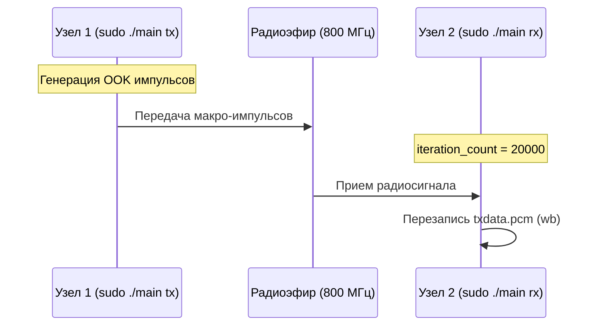

# Отчёт по лабораторной работе: Модернизация приёмопередатчика и реализация OOK-сигналов

> **Период выполнения:** Неделя 7 (19.10 - 25.10)  
> **Тема:** Создание универсальной программы с переключением режимов через аргументы командной строки, реализация амплитудной манипуляции (OOK) и исследование огибающей принятого радиосигнала.

---

## 📡 1. Разработка универсальной архитектуры управления приёмопередатчиком

В течение седьмой недели основной задачей стала переработка программной архитектуры приёмопередатчика. Ранее для изменения режима работы устройств приходилось вручную редактировать исходный код, закомментируя ненужные участки. Такой подход усложнял разработку и требовал постоянного вмешательства в программу.

Для устранения этой проблемы был создан единый файл `main.cpp`, поддерживающий выбор режима работы посредством аргументов командной строки (`tx` или `rx`). В зависимости от переданного параметра программа самостоятельно определяет необходимую конфигурацию и выполняет инициализацию соответствующих потоков и буферов.

Таким образом, удалось перейти к использованию одного исполняемого файла на обоих ноутбуках, без необходимости изменения исходного кода при переключении между передачей и приёмом.



**Реализация выбора режима работы в C++:**

```cpp
int main(int argc, char *argv[]) {
    int is_tx = 0, is_rx = 0;

    // Выбор режима (Tx или Rx) через аргументы командной строки
    if (argc > 1 && strcmp(argv[1], "tx") == 0) {
        is_tx = 1;
    } else if (argc > 1 && strcmp(argv[1], "rx") == 0) {
        is_rx = 1;
    } else {
        printf("Ошибка! Запускайте так: sudo ./main tx ИЛИ sudo ./main rx\n");
        return EXIT_FAILURE;
    }

    // Избирательная настройка параметров
    if (is_rx) SoapySDRDevice_setSampleRate(sdr, SOAPY_SDR_RX, 0, 1e6);
    if (is_tx) SoapySDRDevice_setSampleRate(sdr, SOAPY_SDR_TX, 0, 1e6);
    // ...
}
```

---

## 🛠 2. Выявленные проблемы и выполненные исправления

В процессе тестирования обновлённой программы обнаружились несколько проблем, связанных как с обработкой данных, так и с особенностями взаимодействия с аппаратной частью. Для обеспечения стабильной передачи и приёма потребовалось провести дополнительную диагностику и внести ряд изменений.

### 2.1. Некорректные данные и появление шумов при визуализации

- **Наблюдаемая проблема:** При построении графиков принятого сигнала с помощью Python вместо ожидаемых импульсов отображался хаотичный шум. Полученная осциллограмма не отражала фактическое состояние передачи.
- **Причина:** Выяснилось, что файл буфера `txdata.pcm` открывался в режиме `w` или `a+`. В результате новые данные могли добавляться к информации, оставшейся после предыдущих запусков и незавершённых экспериментов. Из-за этого при анализе использовались не только актуальные отсчёты, но и устаревшие данные.
- **Реализованное решение:** Режим открытия файла был изменён на бинарную перезапись `wb`. Благодаря этому при каждом запуске приёмника содержимое файла полностью обновляется:

```cpp
FILE *file = fopen("txdata.pcm", "wb");
```

### 2.2. Проблема синхронизации передатчика и приёмника

- **Наблюдаемая проблема:** Несмотря на активную работу передающего устройства, приёмник иногда сохранял практически полное отсутствие сигнала.
- **Причина:** Продолжительность выполнения программы ограничивалась 1000-2000 итерациями, что соответствовало очень короткому временному интервалу. При ручном запуске приложений на двух разных ноутбуках добиться точного совпадения времени старта было затруднительно.
- **Реализованное решение:** Для режима `rx` продолжительность приёма была увеличена до `20000` итераций (около 10-15 секунд). Это обеспечило более продолжительное окно прослушивания и позволило приёмнику заранее начать работу, не пропуская момент включения передатчика.

### 2.3. Зависание SDR-платы при остановке потока

- **Наблюдаемая проблема:** После завершения работы программы появлялось сообщение об ошибке `[ERROR] Failed to stop RX stream (-1)`. При этом плата переставала корректно реагировать на последующие команды, и для восстановления работоспособности требовалось повторное физическое подключение через USB.
- **Причина:** После внедрения переключения режимов с помощью флагов `is_rx` и `is_tx` возникла проблема с корректным управлением жизненным циклом потоков. Функции остановки и освобождения ресурсов оказались недоступны или были закомментированы. Это приводило к проблемам с обработкой и освобождением аппаратных буферов AD9361.
- **Реализованное решение:** В программу было добавлено явное завершение работы потоков с отдельной обработкой режима приёма:

```cpp
if (is_rx) {
    SoapySDRDevice_deactivateStream(sdr, rxStream, 0, 0);
    SoapySDRDevice_closeStream(sdr, rxStream);
}
```

---

## 🧮 3. Реализация OOK-модуляции и исследование огибающей сигнала

Следующим этапом работы стала реализация амплитудной манипуляции OOK (On-Off Keying). В отличие от ранее использовавшейся упрощённой трапецеидальной формы в Baseband, теперь программа формирует полноценный радиосигнал с изменяющейся амплитудой.

Принцип генерации заключается в следующем: в первой половине буфера формируется синусоидальный сигнал с частотой 10 кГц, а во второй половине передаваемые значения обнуляются. Таким образом, создаются участки с наличием и отсутствием сигнала, соответствующие принципу OOK.

**Фрагмент реализации генерации сигнала на C++:**

```cpp
double f_tone = 10000.0; // Частота синусоиды внутри импульса (10 кГц)
for (size_t i = 0; i < N; i++) {
    if (i < N / 2) {
        double phase = 2.0 * M_PI * f_tone * ((double)i / 1e6);
        tx_buff[2 * i]     = (int16_t)(max_amp * cos(phase)); // I
        tx_buff[2 * i + 1] = (int16_t)(max_amp * sin(phase)); // Q
    } else {
        tx_buff[2 * i] = 0;      
        tx_buff[2 * i + 1] = 0;  
    }
}
```

Для более наглядного исследования принятого сигнала потребовалось изменить подход к его визуализации. При непосредственном отображении комплексного сигнала на графике присутствовали высокочастотные колебания несущей, которые затрудняли анализ общей формы импульсов.

В связи с этим Python-скрипт был дополнен вычислением математической огибающей комплексного сигнала с использованием библиотеки `numpy`. Для каждого отсчёта определяется модуль комплексного значения, что позволяет отделить информацию об амплитуде от быстрых колебаний несущей.

Математически используемое выражение имеет следующий вид:

$$
Envelope = \sqrt{I^2 + Q^2}
$$

Полученная огибающая позволяет наблюдать непосредственно структуру передаваемых радиоимпульсов и оценивать изменение их амплитуды во времени.

---

## 📸 4. Экспериментальные результаты и анализ принятого сигнала

После внесения программных изменений, устранения проблем с синхронизацией и реализации вычисления огибающей был проведён повторный эксперимент по передаче и приёму OOK-сигнала.

Полученная осциллограмма демонстрирует успешную регистрацию передаваемых импульсов и позволяет проследить поведение аппаратной системы автоматической регулировки усиления.


**Анализ полученной осциллограммы:**

1. **Зелёные импульсы в левой части графика** — результат успешной обработки принятого радиосигнала посредством вычисления его огибающей. Применённый математический метод позволяет преобразовать колебательную форму сигнала в хорошо различимые прямоугольные импульсные участки.

2. **Начальный пик амплитуды (до 3000)** — отражает работу автоматической регулировки усиления (АРУ), реализованной в приёмной плате. До появления полезного сигнала усиление LNA находилось на максимальном уровне. После обнаружения передаваемого сигнала система постепенно уменьшила усиление, в результате чего амплитуда стабилизировалась приблизительно на уровне `~1800`.

3. **Горизонтальный участок в правой части графика** — соответствует шумовой полке (Noise Floor), наблюдаемой после штатного прекращения передачи сигнала.

---

## Заключение

По итогам седьмой недели была существенно переработана программная архитектура системы приёма и передачи. Вместо необходимости вручную изменять исходный код реализован универсальный механизм выбора режима работы через аргументы командной строки, позволяющий использовать один исполняемый файл для обоих устройств.

В ходе тестирования также были обнаружены и устранены проблемы, связанные с накоплением устаревших данных в файле приёма, недостаточной продолжительностью окна прослушивания и некорректным завершением работы аппаратных потоков.

Отдельным результатом стала реализация амплитудной манипуляции OOK, при которой формируются участки с синусоидальным сигналом и нулевой амплитудой. Для анализа полученных данных был дополнен Python-скрипт, вычисляющий математическую огибающую комплексного сигнала.

Проведённый эксперимент подтвердил работоспособность реализованных изменений. На полученной осциллограмме отчётливо прослеживаются передаваемые импульсы, поведение системы автоматической регулировки усиления и уровень фонового шума после завершения передачи.