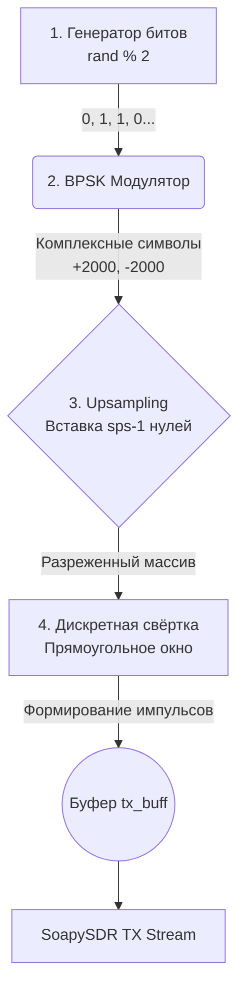

# Отчёт по лабораторной работе: ЦОС, BPSK-модуляция и исследование аппаратных искажений (CFO, LO Leakage)

> **Период выполнения:** Неделя 8 (26.10 - 01.11)  
> **Тема:** Реализация конвейера цифровой обработки сигналов (генерация битов, BPSK-модуляция, upsampling, свёртка) и исследование физических характеристик радиоканала.

---

## 📡 1. Реализация цифрового конвейера передатчика (DSP Pipeline)

В течение восьмой недели основное внимание было уделено созданию полноценного алгоритма цифровой обработки сигналов (DSP) на стороне передатчика.

Вместо ранее использовавшейся генерации простых синусоидальных сигналов была разработана последовательная система формирования цифрового сигнала, включающая несколько этапов обработки. В качестве метода модуляции была выбрана **BPSK (Binary Phase-Shift Keying)**. Данный способ удобен для экспериментальной отладки благодаря своей относительной простоте и использованию только синфазной составляющей сигнала $I$.

**Последовательность обработки сигнала:**

### Основные этапы реализации на C++

Полная реализация алгоритма передатчика размещена в исходном файле [`main_3.cpp`](main_3.cpp).

**1. Формирование последовательности битов**

На первом этапе создаётся массив, содержащий случайную последовательность логических нулей и единиц. Этот массив используется в качестве исходных данных для последующей модуляции.

**2. BPSK-модуляция**

Сформированные биты преобразуются в соответствующие амплитудные значения комплексных символов. Для логического `0` назначается значение $+2000$, а для `1` — $-2000$. При этом квадратурная составляющая ($Q$) остаётся равной нулю, поскольку выбранная схема модуляции использует только канал $I$.

**3. Передискретизация (Upsampling)**

Для формирования символов заданной продолжительности был установлен параметр `sps = 16` (samples per symbol). На данном этапе между соседними модулированными символами добавляется $L-1 = 15$ нулевых отсчётов.

В результате получается разреженная последовательность, в которой полезные значения разделены вставленными нулями.

**4. Дискретная свёртка (Convolution)**

На завершающем этапе выполняется свёртка полученного массива с прямоугольным фильтром $h[k] = [1, 1, \dots, 1]$ длиной 16.

Операция вычисляется по следующему математическому выражению:

$$
y[n] = \sum_{k=0}^{L-1} x[n - k] \cdot h[k]
$$

В результате отдельные ненулевые отсчёты преобразуются в прямоугольные участки постоянной амплитуды. Таким образом формируется последовательность импульсов, подготовленная для последующей передачи через ЦАП.

После завершения всех операций сформированные отсчёты записываются в буфер `tx_buff`, откуда передаются в аппаратный поток SoapySDR TX Stream.

---

## 🛠 2. Оптимизация обработки данных и устранение проблем визуализации

После реализации передающего DSP-конвейера следующим этапом стала проверка принятого сигнала и анализ его характеристик с помощью Python.

При обработке записанного приёмником файла `txdata.pcm`, размер которого составлял около 90 МБ, обнаружились ограничения производительности скрипта и сложности с отображением полезной информации.

Исходный код программы анализа находится в файле [`readPcm.py`](readPcm.py).

В ходе отладки были выявлены три основные проблемы.

### 2.1. Низкая скорость построения графиков

- **Проявление:** Выполнение Python-скрипта, включая обработку файла и построение графиков, занимало около 1.5 минут.
- **Причина:** Чтение большого бинарного файла осуществлялось побайтово с использованием цикла `while` и стандартных списков Python. При количестве данных более 22 миллионов точек такая реализация создавала значительную нагрузку на обработку и последующую визуализацию средствами `matplotlib`.
- **Решение:** Последовательное чтение через циклы было заменено векторизированными операциями библиотеки NumPy. Для загрузки бинарных данных применена функция `np.fromfile()`, позволяющая значительно быстрее считывать весь массив непосредственно в память.

### 2.2. Сложность выделения полезного сигнала на фоне шума

- **Проявление:** При отображении всей записи, содержащей более 20 млн сэмплов, полезный сигнал практически не различался и выглядел как узкая полоса.
- **Причина:** Для повышения вероятности обнаружения передатчика время работы приёмника было намеренно увеличено до `iteration_count = 20000`. В результате значительную часть записи составляли участки с отсутствием полезной передачи — около 90% файла приходилось на пустой эфир.
- **Решение:** Для более детального исследования была реализована ручная обрезка массива по индексам. После предварительного анализа полной записи был определён участок, содержащий импульсную последовательность. Для дальнейшей визуализации использовался диапазон от $1.10 \cdot 10^7$ до $1.14 \cdot 10^7$ сэмплов. Это позволило сосредоточить график непосредственно на полезном сигнале.

### 2.3. Потеря детализации диаграммы созвездия

- **Проявление:** При построении диаграммы созвездия отдельные точки практически сливались, образуя сплошную фиолетовую область в форме кольца.
- **Причина:** Большое количество одновременно отображаемых точек приводило к их наложению друг на друга, из-за чего становилось сложно оценить распределение сигнала.
- **Решение:** Были изменены параметры визуализации `scatter`. Прозрачность точек установлена на уровне `alpha = 0.1`, а исходный массив прорежен в 10 раз с помощью параметра `step = 10`. Благодаря этому удалось уменьшить визуальное наложение точек и сделать структуру диаграммы более различимой.

---

## 📸 3. Исследование радиоканала и анализ аппаратных искажений

После оптимизации обработки данных были получены итоговые графики, позволяющие оценить не только работу реализованного алгоритма BPSK, но и реальные физические особенности передачи сигнала через радиоканал с использованием плат ADALM-Pluto.

В отличие от идеальной математической модели, экспериментальные результаты содержат дополнительные аппаратные эффекты, возникающие из-за особенностей работы передающего и приёмного устройств.

### 3.1. Анализ временной формы принятого сигнала

На левой части рисунка отображается принятая последовательность BPSK-импульсов с компонентами $I$ и $Q$, а также вычисленная огибающая комплексного сигнала.

При рассмотрении осциллограммы можно выделить следующие особенности:

1. **Прямоугольные импульсы BPSK.** Скачки синего ($I$) и красного ($Q$) графиков соответствуют принятым сигналам, форма которых определяется выполненной ранее свёрткой и последующей аппаратной фильтрацией. Зелёная линия, обозначающая огибающую $|z|$, позволяет определить границы импульсной последовательности. При этом амплитуда уменьшилась с первоначальных 2000 до приблизительно 500 вследствие затухания радиосигнала при распространении в воздухе.

2. **Просачивание сигнала гетеродина (LO Leakage).** До появления основной пачки импульсов наблюдается небольшая низкочастотная синусоидальная составляющая с амплитудой около 100. Это связано с аппаратными особенностями AD9361: синтезатор частоты может создавать слабое паразитное излучение даже при нулевых значениях в цифровом передающем буфере.

### 3.2. Исследование диаграммы созвездия и эффекта CFO

В идеальной системе BPSK принятые символы должны формировать два компактных скопления точек на действительной оси $X$, соответствующих значениям $+A$ и $-A$.

Однако на экспериментальной диаграмме наблюдается кольцевая структура. Такое распределение связано с особенностями синхронизации передающего и приёмного устройств.

**1. Сдвиг несущей частоты (CFO — Carrier Frequency Offset)**

Передающая и принимающая платы используют независимые кварцевые резонаторы для формирования тактовых частот. Из-за небольшого различия между их частотами ($\Delta f$) возникает постоянное изменение фазы принятого сигнала во времени.

Данное явление описывается множителем:

$$
e^{j 2 \pi \Delta f t}
$$

В результате идеальные точки BPSK перестают находиться в фиксированных положениях и начинают вращаться вокруг начала координат. При построении диаграммы за продолжительный промежуток времени формируется плотное внешнее кольцо.

Наблюдаемая картина демонстрирует отсутствие общей аппаратной синхронизации между передатчиком и приёмником, в частности с использованием кабеля.

**2. Формирование внутренних колец**

Дополнительные внутренние кольцевые структуры появляются во время изменения передаваемых битов BPSK, когда происходит переход между состояниями $+A$ и $-A$.

Из-за воздействия встроенных FIR-фильтров платы Pluto амплитуда сигнала изменяется не мгновенно. Вместо резкого переключения формируется плавный переход между двумя уровнями.

В процессе этого изменения АЦП фиксирует промежуточные значения сигнала. Одновременно с этим продолжается вращение фазы, вызванное CFO. Совокупность этих процессов приводит к появлению дополнительных кольцевых траекторий внутри основной диаграммы созвездия.

---

## 🏁 Заключение

По итогам восьмой недели был реализован полноценный программный конвейер цифровой обработки сигналов для передающего устройства. Последовательно внедрены генерация случайной битовой последовательности, BPSK-модуляция, передискретизация с параметром `sps = 16` и дискретная свёртка с прямоугольным фильтром.

В процессе анализа экспериментальных данных была проведена оптимизация Python-скрипта. Переход на векторизированную обработку с использованием NumPy позволил ускорить чтение больших бинарных файлов. Также были решены проблемы визуализации, связанные с большим количеством отсчётов, выделением полезного участка сигнала и наложением точек на диаграмме созвездия.

Особое внимание было уделено исследованию физических особенностей радиоканала. На полученных графиках удалось обнаружить и объяснить два аппаратных эффекта: просачивание сигнала гетеродина (LO Leakage) и смещение несущей частоты (CFO).

Таким образом, эксперимент позволил перейти от проверки отдельных алгоритмов цифровой обработки к исследованию реального радиотракта с учётом аппаратных искажений. Полученные результаты создают основу для дальнейшей реализации механизмов частотной и фазовой синхронизации, а также последующей демодуляции принятого сигнала.