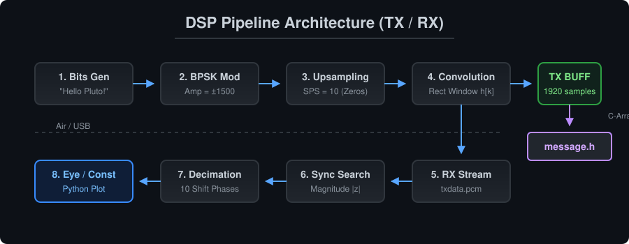

# Отчёт по лабораторной работе №9: Детерминированная передача BPSK, формирование оффлайн-эталона и исследование символьной синхронизации

---

## 1. Цели работы и переход к детерминированной передаче

В ходе предыдущей недели (Неделя 8) была реализована передача псевдослучайной последовательности битов с использованием `rand() % 2`, параметра `sps = 16` и амплитуды `2000`.

Данный подход позволил исследовать общую структуру BPSK-сигнала и получить диаграмму созвездия. Однако в процессе дальнейшей разработки обнаружились ограничения такой реализации.

Главная проблема заключалась в отсутствии повторяемости эксперимента: при каждом запуске передавалась новая последовательность битов. Из-за этого было сложно проверить корректность восстановления информации на стороне приёмника. Дополнительную нагрузку создавало большое время прослушивания (`20000` итераций), в результате которого размер файла `txdata.pcm` достигал примерно 90 МБ.

В связи с этим на девятой неделе работа была направлена на переход к фиксированному сообщению, оптимизацию передачи и подготовку данных для последующей отладки алгоритмов приёма.

**Основные направления работы:**

### 1.1. Разработка передающей части (TX)

1. **Фиксированная последовательность данных.** Вместо случайной генерации битов необходимо сформировать постоянное сообщение, которое не меняется между запусками программы.
2. **Настройка длительности символа.** Установить параметр `sps = 10` сэмплов на один символ (Samples Per Symbol).
3. **Согласование амплитуды.** Уменьшить уровень модуляции до `max_amp = 1500`, учитывая ограничения 12-битного ЦАП платы ADALM-Pluto.
4. **Формирование структуры буфера.** Рассчитать размещение полезных данных в буфере размером `1920` сэмплов с учётом параметра `sps = 10` и служебной информации временной метки `timeNs`.
5. **Организация импульсной передачи.** Реализовать чередование передаваемых буферов и пауз с использованием условия `buffers_read % 2 == 0`.
6. **Создание оффлайн-эталона.** Добавить автоматическую запись сформированного комплексного сигнала в статический C-массив внутри файла `message.h`. Это позволит тестировать алгоритмы приёмника без физического подключения ADALM-Pluto.

### 1.2. Доработка приёмной части (RX)

1. **Сокращение объёма записываемых данных.** Уменьшить количество итераций чтения с `20000` до `3000`, чтобы сократить размер дампа примерно до 11 МБ.
2. **Исследование фаз символьной выборки.** При длительности одного символа `sps = 10` необходимо разделить принятый массив на десять отдельных последовательностей. Каждая из них соответствует своему временному смещению: `0, 10, 20...`, `1, 11, 21...` и так далее. Это необходимо для исследования правильного момента выборки после согласованного фильтра.

---

## 2. Формирование сигнала на передатчике и расчёт структуры буфера

<div align="center">
  
</div>

### 2.1. Обоснование выбора амплитуды `max_amp = 1500`

При настройке передающего сигнала необходимо учитывать физические ограничения радиочастотного трансивера **AD9361**, установленного на плате ADALM-Pluto.

В устройстве используются 12-битные цифро-аналоговые и аналого-цифровые преобразователи. Поскольку значения отсчётов представлены в знаковом формате (дополнительный код), допустимый диапазон ЦАП составляет:

$$
D_{\text{DAC}} \in [-2^{11}, \, 2^{11} - 1] = [-2048, \, +2047]
$$

В предыдущей реализации применялась амплитуда `2000`, что соответствовало приблизительно $97.7\%$ от максимального значения шкалы.

Использование настолько высокого уровня сигнала создаёт вероятность возникновения насыщения (клиппинга) при прохождении через внутренние цифровые интерполирующие фильтры и аналоговый усилительный каскад. Подобные искажения способны негативно влиять на спектральные характеристики передаваемого сигнала.

Поэтому было принято решение снизить амплитуду до **`max_amp = 1500`**. Это составляет приблизительно $73\%$ от полной шкалы преобразователя и обеспечивает запас по уровню (headroom $\approx 2.7\text{ дБ}$).

Таким образом, выбранное значение позволяет уменьшить вероятность ограничения сигнала и обеспечить работу передающего тракта в линейной области.

### 2.2. Распределение данных внутри буфера `tx_mtu = 1920`

Следующим этапом стало определение того, сколько полезной информации можно разместить в одном аппаратном пакете.

При использовании настройки `timestamp_every = 1920` размер одного буфера составляет ровно $N = 1920$ комплексных I/Q-сэмплов.

Каждый комплексный отсчёт представлен двумя значениями типа `int16_t`: одно отвечает за канал $I$, второе — за канал $Q$.

Следовательно, полный размер массива `tx_buff` составляет:

$$
L_{\text{buff}} = 2 \times 1920 = 3840
$$

элементов типа `int16_t`.

Рассмотрим распределение этого пространства.

**1. Служебная информация временной метки (`timeNs`)**

При использовании режима `direct=1` драйвер PlutoSDR задействует начальные элементы буфера для передачи информации о времени отправки.

В частности:

- `tx_buff[0..1]` и `tx_buff[10..11]` заполняются значениями `0xffff`;
- в диапазон `tx_buff[2..9]`, содержащий 8 элементов `int16_t`, записывается 64-битная временная метка;
- время отправки рассчитывается выражением `tx_time = last_time + 4000000` нс.

В результате первые **12 элементов `int16_t` (6 комплексных сэмплов)** используются под служебные данные и не могут применяться для размещения полезного сообщения.

**2. Активная область передачи (`active_len`)**

Для удобства анализа временной структуры сигнала полезная информация размещается только в первой половине буфера.

Количество доступных комплексных отсчётов составляет:

$$
N_{\text{active}} = \frac{N}{2} = \frac{1920}{2} = 960 \text{ сэмплов}
$$

Таким образом, под передачу полезного сигнала выделяется 960 комплексных сэмплов.

**3. Расчёт информационной ёмкости**

В качестве схемы модуляции используется BPSK, где $M = 2$.

Количество битов на один символ:

$$
\log_2(2) = 1 \text{ бит на символ}
$$

При коэффициенте передискретизации `sps = 10` информационная ёмкость активной части определяется следующим образом:

$$
N_{\text{bits}} =
\frac{N_{\text{active}}}{\text{sps}} \times \log_2(M)
$$

$$
N_{\text{bits}} = \frac{960}{10} \times 1 = 96 \text{ бит} = 12 \text{ байт}
$$

Следовательно, один активный интервал позволяет передать ровно 96 бит информации.

**4. Формирование паузы**

Вторая половина буфера, соответствующая диапазону `i = 960..1919`, полностью заполняется нулевыми значениями:

- $I = 0$;
- $Q = 0$.

Это позволяет сформировать временной интервал без полезной модуляции внутри одного MTU.

### 2.3. Формирование фиксированного сообщения и BPSK-модуляция

Для обеспечения повторяемости эксперимента генератор случайных чисел был заменён на постоянную ASCII-строку `"Hello Pluto!"`.

Сообщение состоит ровно из **12 символов**, что соответствует:

$$
12 \times 8 = 96 \text{ бит}
$$

Таким образом, его длина полностью совпадает с рассчитанной информационной ёмкостью активной части буфера.

Преобразование строки в последовательность битов выполняется от старшего бита (MSB) к младшему (LSB) посредством побитового сдвига и маскирования.

**Реализация на C++:**

```cpp
// 1. Генератор фиксированных битов (строка "Hello Pluto!", 12 байт = 96 бит)

int bits[num_bits];

const char* message = "Hello Pluto!"; 

for (size_t i = 0; i < num_bits; i++) {

    char c = message[i / 8];

    bits[i] = (c >> (7 - (i % 8))) & 1; 
}
```

Для проверки правильности преобразования можно рассмотреть первые два символа сообщения:

- `'H'` (ASCII `0x48` = $72_{10}$) → `0 1 0 0 1 0 0 0`
- `'e'` (ASCII `0x65` = $101_{10}$) → `0 1 1 0 0 1 0 1`

После получения битовой последовательности выполняется стандартная цепочка цифровой обработки.

**1. Отображение битов в символы BPSK**

Каждому биту назначается определённое значение амплитуды:

- `0` преобразуется в $+1500.0$;
- `1` преобразуется в $-1500.0$.

Квадратурный канал остаётся нулевым ($Q = 0$).

**2. Передискретизация (Upsampling)**

Для каждого символа создаётся последовательность длиной `sps = 10`. Между исходными ненулевыми значениями добавляется $\text{sps} - 1 = 9$ нулевых отсчётов.

Математически процесс можно представить выражением:

$$
x_{\text{up}}[n] =
\begin{cases}
\text{sym\_I}[n / 10], & n \bmod 10 = 0 \\
0, & \text{иначе}
\end{cases}
$$

**3. Формирование импульсов с помощью свёртки**

Полученный разреженный массив обрабатывается прямоугольным формирующим фильтром:

$$
h[k] = [1, 1, 1, 1, 1, 1, 1, 1, 1, 1]
$$

Длина фильтра составляет 10 отсчётов.

Операция дискретной свёртки выполняется по формуле:

$$
y[i] = \sum_{k=0}^{9} x_{\text{up}}[i - k] \cdot h[k]
$$

Фактически данная операция реализует удержание нулевого порядка (Zero-Order Hold). Каждый исходный импульс с амплитудой $\pm 1500$ сохраняется на протяжении 10 последовательных отсчётов.

В результате получаются прямоугольные импульсы длительностью $10\text{ мкс}$ при частоте дискретизации $f_s = 1\text{ МГц}$.

### 2.4. Автоматическое создание файла `message.h`

Для упрощения дальнейшей разработки была реализована дополнительная возможность автоматического экспорта сформированного сигнала.

Основная идея заключается в том, чтобы сохранять содержимое передающего буфера непосредственно в C-заголовочный файл `message.h`.

Это избавляет от необходимости вручную переносить большое количество числовых значений и позволяет использовать сформированный эталонный сигнал в отдельных тестовых программах без подключения аппаратной платы.

**Реализация генерации файла:**

```cpp
// Автогенерация message.h со статическим массивом при старте TX

FILE *fh = fopen("message.h", "w");

if (fh) {

    fprintf(fh, "#ifndef MESSAGE_H\n#define MESSAGE_H\n\nconst int16_t tx_static_buffer[%lu] = {\n    ", 2 * tx_mtu);

    for (size_t i = 0; i < 2 * tx_mtu; i++) {

        fprintf(fh, "%d", tx_buff[i]);

        if (i < 2 * tx_mtu - 1) {

            fprintf(fh, ", ");

            if ((i + 1) % 16 == 0) fprintf(fh, "\n    ");

        }

    }

    fprintf(fh, "\n};\n\n#endif\n");

    fclose(fh);

}
```

После выполнения этого блока создаётся файл `message.h`, содержащий статический массив:

`tx_static_buffer[3840]`.

Теперь в любом тестовом проекте на Cи достаточно подключить:

```cpp
#include "message.h"
```

После этого эталонный массив с комплексными отсчётами сформированного передатчиком сигнала становится доступен непосредственно в памяти программы.

---

## 3. Физический принцип работы гетеродина и его влияние на радиосигнал

Для правильной интерпретации полученных экспериментальных графиков необходимо рассмотреть работу гетеродина (Local Oscillator, LO), являющегося одним из ключевых элементов радиочастотного трансивера.

Программный код формирует прямоугольные импульсы с частотой дискретизации $1\text{ МГц}$. Это низкочастотное представление сигнала, которое также называется основной полосой (Baseband).

Однако для эффективного излучения через антенну ADALM-Pluto необходимо перенести сигнал в область значительно более высоких частот. В нашем эксперименте используется радиочастота **$800\text{ МГц}$**.

Для этого в микросхеме AD9361 предусмотрен гетеродин — высокочастотный генератор, формирующий опорную волну на заданной частоте.

Рассмотрим его работу в обоих направлениях радиотракта.

**Передача (TX)**

На передающей стороне смеситель перемножает сформированный базовый сигнал с колебанием гетеродина частотой $800\text{ МГц}$. В результате происходит перенос спектра исходного сигнала в радиочастотную область, после чего он может излучаться антенной.

**Приём (RX)**

В приёмном тракте используется аналогичный принцип. Собственный гетеродин приёмника также формирует сигнал на частоте $800\text{ МГц}$. С помощью смесителя принятый радиосигнал преобразуется обратно в низкочастотную область и поступает в массив `rx_buffer`.

Именно особенности работы этих генераторов объясняют два важных аппаратных эффекта.

### 3.1. Просачивание сигнала гетеродина (LO Leakage)

Внутри микросхемы AD9361 высокочастотный генератор физически расположен очень близко к выходному усилительному каскаду.

Из-за паразитных ёмкостных связей часть энергии гетеродина может проникать непосредственно в выходной тракт и попадать в антенну.

Особенность этого явления заключается в том, что паразитный сигнал способен присутствовать даже при полностью нулевом содержимом цифрового буфера:

`I = 0, Q = 0`.

Следовательно, отсутствие полезной цифровой модуляции не всегда означает полное отсутствие радиочастотного излучения.

### 3.2. Расхождение частот гетеродинов (CFO)

Передающая и принимающая платы используют независимые кварцевые резонаторы. Поэтому частоты их гетеродинов не совпадают абсолютно точно.

Например, один генератор может работать на частоте:

$800\,000\,000\text{ Гц}$,

а второй — на:

$800\,011\,450\text{ Гц}$.

Разность между ними составляет:

$$
\Delta f \approx 11.45\text{ кГц}
$$

Это явление называется Carrier Frequency Offset (CFO).

Из-за данной частотной расстройки комплексный вектор принятого сигнала в координатах $(I, Q)$ непрерывно изменяет свою фазу. На диаграмме созвездия это проявляется в виде вращения точек вокруг центра координат.

---

## 4. Сопоставление экспериментальных графиков и математическая интерпретация

После перехода к детерминированному сообщению были получены два основных варианта визуализации принятого сигнала.

В процессе анализа возникли вопросы относительно геометрии диаграммы созвездия. В частности, требовалось объяснить, почему на девятой неделе кольцевая структура выглядит более упорядоченной, а точки располагаются отдельными дугами, а не формируют сплошное заполненное кольцо, как в предыдущем эксперименте.

Для ответа на эти вопросы были рассмотрены два режима отображения данных.

### 4.1. Первый график: выделенный пакет и прореженная диаграмма созвездия


На первом графике рассматривается ограниченный участок записи, содержащий полезную передачу. Дополнительно применяется прореживание данных для более наглядного отображения структуры созвездия.

### 4.2. Второй график: полная запись эфира без прореживания


*Рис. 2. Полная запись приёмника (3000 буферов = 5.76 млн сэмплов) и диаграмма созвездия, построенная по всем исходным отсчётам.*

Второй вариант отображения охватывает всю запись, полученную приёмником. В отличие от первого графика, здесь используются все имеющиеся отсчёты без дополнительного прореживания.

### 4.3. Проверка экспериментальных результатов расчётами

Для подтверждения правильности полученных результатов были сопоставлены параметры программной реализации и фактические характеристики записанного сигнала.

**Проверка №1. Определение общего количества записанных сэмплов**

В программе приёмника установлены следующие параметры:

- `iteration_count = 3000`;
- `rx_mtu = 1920`.

Следовательно, ожидаемое количество комплексных отсчётов определяется выражением:

$$
N_{\text{total}} = 3000 \times 1920
$$

$$
N_{\text{total}} = 5\,760\,000 = 5.76 \times 10^6 \text{ сэмплов}
$$

Полученное значение соответствует окончанию временной оси на втором графике (Рис. 2), где запись заканчивается приблизительно на отметке **$5.76 \times 10^6$**.

Поскольку полезная передача занимает лишь небольшую часть всей записи, на полном графике она отображается как узкий участок около $0.27 \times 10^6$, то есть приблизительно на отметке $272\,000$-го сэмпла.

**Проверка №2. Исследование двух уровней амплитуды принятого пакета**

На увеличенном временном графике (Рис. 1) в диапазоне между сэмплами `272000` и `282000` наблюдаются две характерные ступени.

Их амплитуды составляют приблизительно 1650 и 850 соответственно.

**Первый участок (`272100` – `276000`)**

На данном интервале огибающая комплексного сигнала:

$$
|z| = \sqrt{I^2 + Q^2}
$$

удерживается на уровне **$\approx 1650$**.

Это соответствует активной передаче 96 бит сообщения `"Hello Pluto!"`. К заданной амплитуде `1500` добавляется векторная составляющая, связанная с излучением несущей частоты.

**Второй участок (`276000` – `281800`)**

На следующем интервале амплитуда уменьшается приблизительно в два раза и составляет **$\approx 850$**.

При этом сигнал не исчезает полностью. Такое поведение объясняется тем, что в данный момент передатчик находится в интервале, где полезная модуляция отсутствует: вторая половина буфера заполнена нулями (`tx_buff = 0`), либо пропускается нечётный буфер согласно условию `buffers_read % 2 == 0`.

Несмотря на отсутствие полезных данных, передающий аппаратный тракт остаётся активным. Поэтому в эфире продолжает присутствовать немодулированный сигнал, обусловленный утечкой гетеродина (LO Leakage).

Когда цикл `do_tx` завершается и программа выполняет закрытие потока `SoapySDRDevice_deactivateStream` (отметка `281800`), передающий усилитель отключается, вследствие чего наблюдаемый сигнал падает до нулевого уровня.

**Проверка №3. Расчёт частотной расстройки CFO**

Для оценки частотного сдвига рассмотрим синусоидальную составляющую синего графика, соответствующую каналу $I$.

На первом участке длиной примерно $\Delta N \approx 3840$ сэмплов, то есть на двух активных интервалах, наблюдается **11 полных колебаний**.

Тогда период одного колебания в отсчётах равен:

$$
T_{\text{CFO}} = \frac{3840}{11} \approx 349.1 \text{ сэмплов}
$$

При частоте дискретизации $f_s = 10^6\text{ Гц}$ частотная разность определяется следующим образом:

$$
\Delta f_{\text{CFO}} =
\frac{f_s}{T_{\text{CFO}}}
$$

$$
\Delta f_{\text{CFO}} =
\frac{1\,000\,000}{349.1}
\approx 2864.5 \text{ Гц}
$$

или приблизительно $11.45\text{ кГц}$ на один полубуфер длиной 960 сэмплов.

Изменение фазы за один отсчёт можно оценить по формуле:

$$
\Delta \varphi =
\frac{360^\circ}{349.1}
\approx 1.031^\circ
$$

(при $T=349$), либо:

$$
\Delta \varphi =
360^\circ \times \frac{11}{960}
= 4.125^\circ \text{ за сэмпл}
$$

Таким образом, экспериментальные колебания позволяют оценить величину частотной расстройки между независимыми генераторами передающей и принимающей плат.

**Проверка №4. Объяснение структуры двух колец на диаграмме созвездия**

Для анализа правых частей графиков необходимо отдельно рассмотреть происхождение внешнего и внутреннего колец.

**1. Внешнее кольцо (радиус $R_1 \approx 1650$)**

Данная область соответствует передаче полезного BPSK-сообщения `"Hello Pluto!"`.

Поскольку каждый символ содержит `sps = 10` одинаковых отсчётов, за время передачи одного символа комплексный вектор проходит дугу, состоящую из 10 дискретных точек.

При смене бита с `0` на `1` происходит изменение фазы на $180^\circ$. Поэтому точки перехода располагаются на противоположной стороне окружности, а между ними наблюдаются диагональные переходные участки через центр координат.

**2. Внутреннее кольцо (радиус $R_2 \approx 850$)**

Внутренняя окружность связана с интервалами отсутствия полезной модуляции.

В эти моменты цифровой буфер содержит нули, однако аппаратный передающий тракт продолжает работать и излучает паразитную составляющую гетеродина.

Поскольку полезные переключения фазы отсутствуют, вектор описывает окружность приблизительно постоянного радиуса $850$.

**3. Причины дискретного расположения точек на обоих графиках**

Отдельного рассмотрения требует тот факт, что даже на втором графике, где отображаются абсолютно все отсчёты, кольца выглядят как набор отдельных точек.

На восьмой неделе передавалась случайная последовательность `rand() % 2` на протяжении 20000 буферов. Из-за большого количества случайных изменений битов и длительного времени передачи точки распределялись по окружности значительно равномернее, создавая эффект сплошного кольца.

В текущем эксперименте используется фиксированное сообщение `"Hello Pluto!"`, передаваемое на ограниченном временном интервале.

Кроме того, вращение фазы происходит с определённым шагом дискретизации. Поэтому каждый последующий отсчёт попадает в одну из фиксированных угловых позиций:

$$
\varphi_k = \varphi_0 + k \cdot \Delta \varphi
$$

На первом графике (`step`) дополнительно пропускает часть промежуточных точек, что усиливает визуальный эффект отдельных дуг.

На втором графике (`step` отключён), поэтому отображаются **все 100% записанных сэмплов АЦП**. Каждая точка соответствует реальному дискретному отсчёту, полученному с частотой $1\text{ МГц}$.

---

## 5. Разделение принятого сигнала на 10 фаз символьной выборки

После исследования структуры принятого сигнала следующим этапом стала подготовка данных для символьной синхронизации.

Поскольку длительность каждого BPSK-символа составляет `sps = 10` отсчётов, для определения переданного бита нет необходимости использовать все десять значений одновременно.

Задача приёмника заключается в выборе одного наиболее подходящего отсчёта из каждого символьного интервала. Такая операция представляет собой децимацию в 10 раз.

Однако положение оптимального момента выборки заранее неизвестно. Поэтому необходимо проверить все возможные временные смещения.

При `sps = 10` существует ровно **10 независимых фаз выборки**, соответствующих индексам `offset` от `0` до `9`.

| Номер списка | Индексы сэмплов | Характеристика выборки |
|:---:|:---|:---|
| **Список 0** | `0, 10, 20, 30, 40, ...` | Начало символа, переходный процесс и фронт фильтра |
| **Список 1** | `1, 11, 21, 31, 41, ...` | Нарастание амплитуды после изменения знака |
| **Список 2** | `2, 12, 22, 32, 42, ...` | Выход сигнала на плоскую часть импульса |
| **Список 3** | `3, 13, 23, 33, 43, ...` | Приближение к центральной части импульса |
| **Список 4** | `4, 14, 24, 34, 44, ...` | **Оптимальная точка выборки (центр импульса, максимум энергии)** |
| **Список 5** | `5, 15, 25, 35, 45, ...` | **Оптимальная точка выборки (центр импульса, максимум энергии)** |
| **Список 6** | `6, 16, 26, 36, 46, ...` | Плоская часть импульса перед спадом |
| **Список 7** | `7, 17, 27, 37, 47, ...` | Приближение к границе следующего символа |
| **Список 8** | `8, 18, 28, 38, 48, ...` | Начальный этап спада при смене следующего бита |
| **Список 9** | `9, 19, 29, 39, 49, ...` | Край символьного интервала, максимальное влияние межсимвольных искажений |

Таким образом, каждый список представляет собой отдельную последовательность отсчётов, полученную при фиксированном смещении относительно начала исходного массива.

### Реализация разделения в Python

В файле `scripts/readPcm.py` для формирования десяти последовательностей используются срезы NumPy с шагом `sps = 10`.

```python
sps = 10

phases = []

# Формируем 10 списков (фаз символьной синхронизации):
# phases[0] -> сэмплы 0, 10, 20, 30...
# phases[1] -> сэмплы 1, 11, 21, 31...
# ...
# phases[9] -> сэмплы 9, 19, 29, 39...

for offset in range(sps):

    phase_samples = packet_mag[offset::sps]

    phases.append(phase_samples)
```

В результате формируется массив `phases`, содержащий десять вариантов символьной выборки.

Дальнейшее сравнение полученных последовательностей позволяет определить, какое временное смещение обеспечивает наиболее корректное попадание в центральную область импульсов.

---

## 6. Возникшие проблемы в процессе разработки и способы их устранения

В ходе выполнения лабораторной работы возникло несколько практических проблем, связанных с рефакторингом программы, организацией передачи между двумя устройствами и обработкой комплексных данных.

### 6.1. Потеря конфигурации подключения и проверок TX при изменении `main.cpp`

**Причина возникновения:**

Во время очистки исходного кода от устаревших конструкций случайно был удалён блок выбора способа подключения устройства:

`if (1) { uri = "usb:"; } else { uri = "ip:192.168.2.1"; }`

Также была потеряна проверка ошибок при настройке коэффициентов усиления с помощью `SoapySDRDevice_setGain`.

Дополнительно компилятор сообщил предупреждение:

`warning: unused variable 'st' [-Wunused-variable]`

Оно появилось после удаления проверки:

`if ((size_t)st != tx_mtu)`

которая должна выполняться после вызова `SoapySDRDevice_writeStream`.

**Способ устранения:**

Был восстановлен исходный конфигурационный блок подключения, а также возвращена проверка значения `st`, получаемого при записи данных в TX-поток.

Это важно для своевременного обнаружения ошибок передачи, особенно при использовании двух ноутбуков и различных способов подключения платы — через USB или IP.

Восстановленные проверки позволяют оперативно обнаруживать проблемы и выводить соответствующие сообщения, включая `TX Failed`.

### 6.2. Согласование времени запуска передатчика и приёмника

**Причина возникновения:**

После сокращения количества итераций с `20000` до `3000` возникла проблема синхронизации запуска двух устройств.

Если одинаково ограничить продолжительность работы и для `tx`, и для `rx`, приёмник может завершить запись ещё до того, как оператор успеет запустить передачу на втором ноутбуке.

**Способ устранения:**

Для режимов передачи и приёма было предусмотрено раздельное управление продолжительностью работы посредством тернарного оператора:

```cpp
size_t iteration_count = (do_rx && !do_tx) ? 3000 : 2000;
```

Также была определена последовательность запуска устройств:

1. Сначала запускается программа в режиме `rx`.
2. Через 0.5–1 секунду запускается передатчик командой `./main tx`.

Это позволяет приёмнику заранее начать запись и с высокой вероятностью захватить передаваемый пакет.

В результате полезная посылка фиксируется в первой трети записи — примерно на 272-тысячном сэмпле из общего количества 5.76 млн.

При этом размер файла `txdata.pcm` уменьшился с 90 МБ до 22 МБ.

### 6.3. Некорректное отображение фаз выборки при использовании канала I

**Причина возникновения:**

При первой попытке построить графики для последовательностей `phases[0]`, `phases[4]` и `phases[8]` использовался исходный массив `real_np`, содержащий только действительную составляющую принятого сигнала.

В результате вместо ожидаемых прямоугольных уровней $\pm 1500$ на графиках отображалась плавная синусоидальная зависимость.

Причина заключается в наличии частотного рассогласования между гетеродинами передатчика и приёмника (CFO).

Из-за вращения фазы проекция комплексного сигнала на ось $I$ изменяется по закону:

$$
I(t) \propto \cos(2\pi \Delta f t)
$$

Поэтому непосредственный анализ только действительной составляющей не позволяет корректно оценивать амплитуду сигнала.

**Способ устранения:**

Было принято решение использовать модуль комплексного сигнала:

$$
|z| = \sqrt{I^2 + Q^2}
$$

В отличие от отдельных компонент $I$ и $Q$, огибающая не зависит от текущего угла поворота комплексного вектора.

Поэтому до реализации компенсации частотного сдвига с помощью фазовой автоподстройки (PLL / Costas Loop) для анализа амплитуды и выбора символьных отсчётов используется именно комплексная огибающая.

---

## 7. Итоговые результаты работы

По результатам девятой недели удалось выполнить переход от передачи случайных данных к формированию повторяемого цифрового сообщения и подготовить основу для дальнейшей разработки приёмника.

Основные результаты:

1. Разработан детерминированный передатчик BPSK, формирующий фиксированный 96-битный кадр `"Hello Pluto!"`. Установлены параметры `sps = 10` и амплитуда `1500`, выбранная с учётом линейного диапазона 12-битного ЦАП AD9361.

2. Реализована автоматическая генерация заголовочного файла `message.h`, содержащего статический C-массив `tx_static_buffer[3840]`. Это обеспечивает возможность тестирования алгоритмов цифровой обработки и демодуляции без непосредственного подключения аппаратной платы.

3. Выполнена проверка соответствия экспериментальных графиков параметрам передаваемого сигнала. Исследованы временная структура пакета и особенности двухколечной диаграммы созвездия. Также проведена оценка частотной расстройки гетеродинов ($\Delta f_{\text{CFO}}$) и объяснено появление дискретных дуг на диаграмме при использовании фиксированной битовой последовательности.

4. Реализовано разделение принятого сигнала на десять независимых фаз символьной выборки с использованием срезов NumPy. Это создаёт основу для определения оптимального момента принятия решения о переданном бите.

Таким образом, в ходе лабораторной работы была подготовлена воспроизводимая система формирования и передачи BPSK-кадра, создан оффлайн-эталон передаваемых данных и выполнена предварительная подготовка приёмного алгоритма к этапу символьной синхронизации.